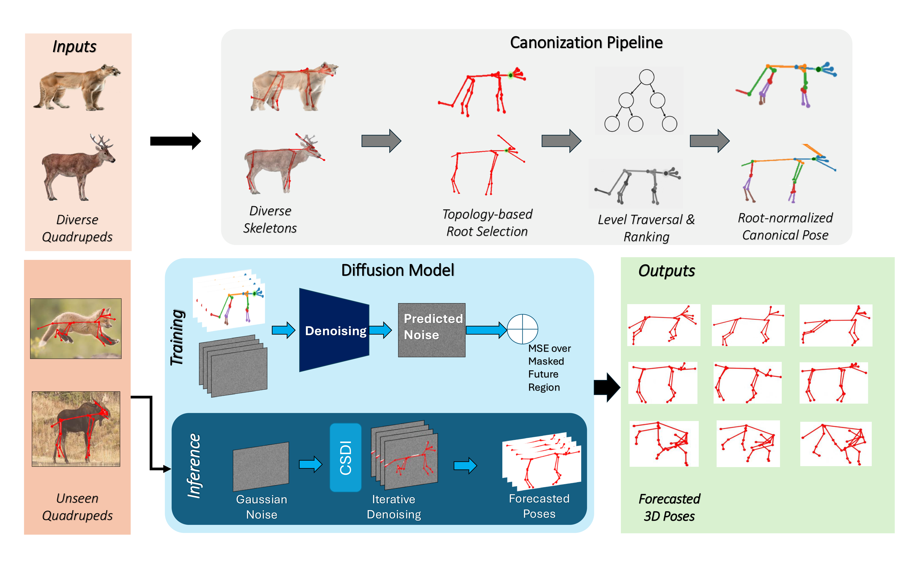
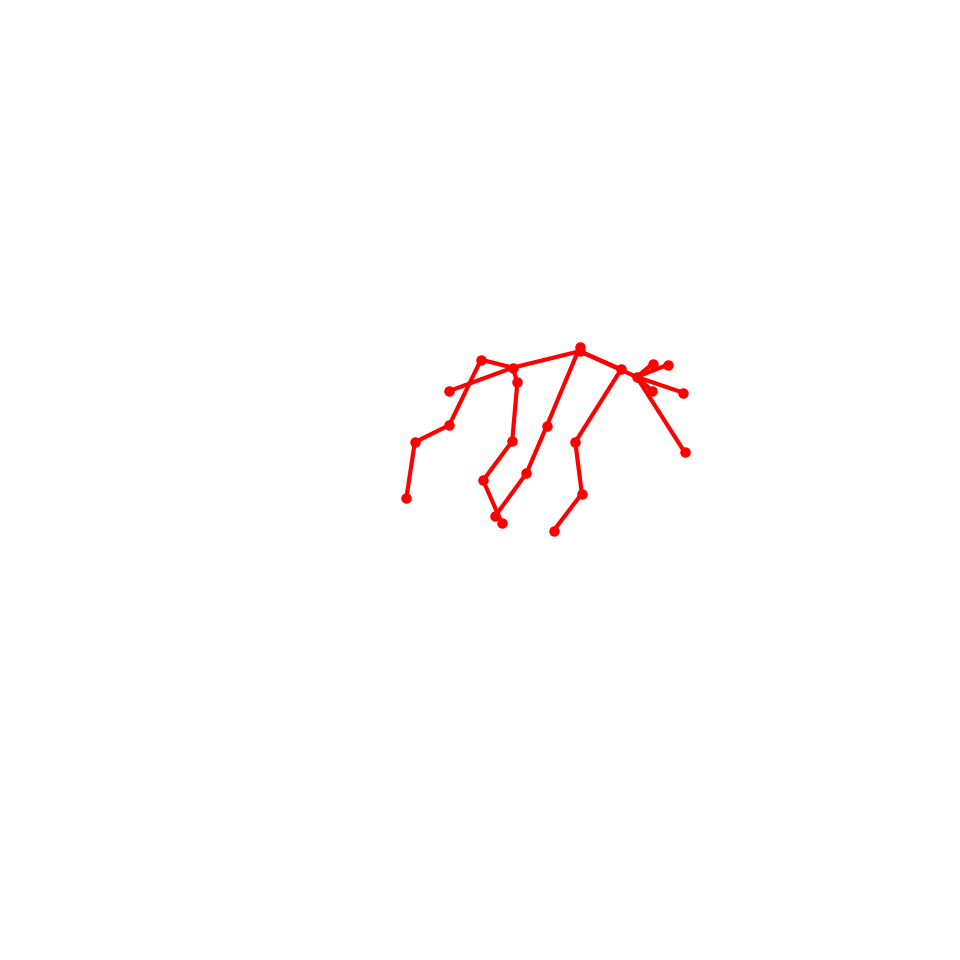

# Semantic-Skeleton
The Github Repository for the Paper Semantic-Skeleton: Canonizing Quadruped Skeletons for Cross-Skeletal Pose Forecasting

# Problem
Pose Forecasting today is mainly focused on humans, with limited works regarding animals. Works regarding animals in 3D pose forecasting do not support inferences across different animals with the same model, and do not support inference on unseen animals.
# Overview
We propose Semantic-Skeleton, a first step towards subject-agnostic pose-forecasting and cross-subject pose forecasting. Semantic-Skeleton is split into two steps: (i) a canonization pre-processing step, and (ii) a diffusion model for the outputs. 
## Canonization Step
Each quadruped skeleton is represented as a graph, and the most connected joint is selected as the root. Joints are then grouped by their distance from the root and ranked by structural importance. A fixed number of joints is retained from each level to create a shared 25-joint skeleton, followed by root normalization to remove global position differences.
## Diffusion Model
The canonized pose sequence is split into observed past frames and future frames to predict. A conditional diffusion model adds noise during training and learns to reconstruct the future poses while keeping the observed frames fixed. For longer predictions, a short-term forecast is first generated and then used as extra context for the long-term model.

## Training
Training is performed in two stages. The short-term model first learns to predict the next 5 frames from the observed pose history. 
The long-term model is then trained to predict the full future horizon. During inference, the short-term prediction is inserted as additional context before the long-term model generates the remaining future poses
```bash
python train_short.py \
  --mode train \
  --data_dir ./data \
  --input_n 20 \
  --output_n 5 \
  --joints 25 \
  --epochs 100 \
  --output_dir model_s
```
```bash
python train_long.py \
  --mode train \
  --data_dir ./data \
  --input_n 20 \
  --output_n 15 \
  --joints 25 \
  --epochs 100 \
  --output_dir model_l
```
### 3. **Evaluation**
Evaluation uses the trained short-term and long-term models in a two-stage forecasting pipeline. The short-term model first predicts the next 5 frames, and the mean of five diffusion samples is inserted as additional observed context. The long-term model then predicts the remaining future frames. The script reports MPJPE, PCP, Bone Error, Bone Length Error, and Bone Standard Deviation. It also saves predictions and ground-truth poses for every sliding window, along with overall, per-animal, and motion-based metric summaries.
```bash
python infer.py \
  --data_dir ./data \
  --input_n 20 \
  --output_n 15 \
  --joints 25 \
  --model_s model_s \
  --model_l model_l \
  --nsample 5 \
  --batch_size 32 \
  --save_dir eval_results
```
The overall flow of Semantic-Skeleton is portrayed in the following diagram:

<p align="center">
  
</p>

### Prediction Examples

<table> <tr> <td></td> <td></td> </tr> </table>

### BibTex Citation 
```bibtex
@inproceedings{noronha2025quadforecaster,
  title={QuadForecaster: Diffusion-Based Quadruped Pose Prediction for Animal Communication Analysis},
  author={Noronha, Ian and Chowdhury, Aneeq and Bharti, Saru and Kaur, Upinder},
  booktitle={NeurIPS 2025 Workshop on AI for Animal Communication},
  year={2025},
  url={https://openreview.net/forum?id=tqSRcqCpqJ}
}
```
---
